 

  

&nbsp;

&nbsp;

  

[Website](https://darks.app) · [Documentation](https://darks.app/en/docs) · [Get started](./docs/getting-started.md) · [Features](./docs/features.md)

 

### A better place to hang out.

Dark brings giveaways, moderation, support, music, and member progression into one Discord bot. Set up the routines once, manage them from your browser, and spend more time with your community.

  

### Your rules. Their next favorite event.

Create giveaways with role, membership, activity, or voice requirements. Let Dark check eligibility, choose winners, and handle supported reward deliveries. Your events stay organized as your community grows.

[Explore giveaways](https://darks.app/en/explore/giveaways) · [See all features](./docs/features.md)

### From invite to your first event.

1. **[Add Dark to your server](https://discord.com/api/oauth2/authorize?client_id=1012459997042593802&permissions=8&scope=bot+applications.commands&redirect_uri=https%3A%2F%2Fdarks.app%2Fdashboard2&response_type=code).** Select a server you can manage and review Discord's permission request.
2. **[Open your dashboard](https://darks.app/en/dashboard2).** Sign in with Discord and choose your server.
3. **Make it yours.** Configure your first giveaway, moderation rules, or welcome flow.

[Read the quick start →](./docs/getting-started.md)

### Need a hand?

Join the **[support server](https://discord.gg/sQH6t2Ct9f)** for setup help and account questions. Found a reproducible bug or have a feature in mind? [Open an issue](https://github.com/TMBilalTM/Dark/issues/new/choose).

<b>Can I download or self-host Dark?</b>

 
Dark is a hosted bot. This repository contains its public overview and user guides. The bot's source code and infrastructure are private. To use Dark, add the official bot to your server.

<b>Where do I change my server settings?</b>

 
Use the <a href="https://darks.app/en/dashboard2">web dashboard</a>. Select a server you can manage, then open the module you want to configure. If your server is missing, check that Dark has joined and that your Discord account can manage the server.

<b>Does every feature come with the same plan?</b>

 
Availability and limits can vary. Check the current <a href="https://darks.app/en/pricing">plans</a> before choosing a feature for your server.

 

[Privacy](https://darks.app/en/privacy-policy) · [Terms](https://darks.app/en/terms-of-service) · [Support](https://discord.gg/sQH6t2Ct9f)

© 2026 Dark · Created by <a href="https://github.com/TMBilalTM">Bilal Aksoy</a>

